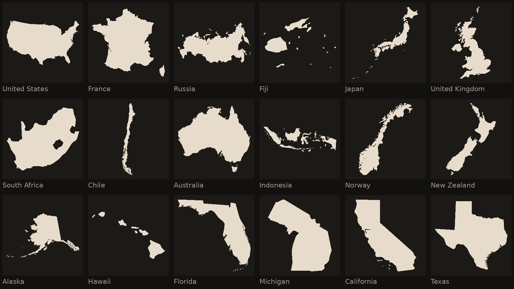

# Fathom

Name the outline. Measure the miss.

Fathom is an iOS game. One filled silhouette appears — a US state or a country — with no labels and no map around it. You get six guesses. Each miss shows the great-circle distance from that guess to the answer, a compass arrow pointing toward it, and a proximity percentage. Guess it, or miss six times, and the name is revealed.

There is a daily puzzle, the same outline for everyone on a given UTC date, and an unlimited practice mode. Daily progress and a simple record (played, win percentage, streak, guess distribution) stay on the device.

Fathom is an independent game. It is not affiliated with any other geography puzzle.



## Run it on a simulator

You need Xcode 15 or later and an iOS 17 simulator.

1. Open `App/Fathom.xcodeproj`.
2. Choose the **Fathom** scheme and an iPhone or iPad simulator running iOS 17 or newer.
3. Press Run.

The project uses manual ad-hoc signing (`CODE_SIGN_IDENTITY = "-"`, `CODE_SIGNING_REQUIRED = NO`) so a simulator build does not ask for an Apple Developer team. To install on a device, select your team under Signing & Capabilities and switch that target to automatic signing.

The SwiftUI app links the local `FathomCore` package at the repo root. Outline geometry is already bundled at `Sources/FathomCore/Resources/regions.json`, so the app builds without a network connection.

## Tests

From the repo root, with Swift 5.9 or later:

```bash
swift test
```

The tests cover great-circle distance, initial bearing, proximity, the deterministic daily index, name matching, streaks, and the bundled catalog. They do not compile the SwiftUI app.

## Regenerating the shapes

Outlines are simplified from [Natural Earth](https://www.naturalearthdata.com/) 1:50m cultural vectors, which are in the public domain:

- Admin-0 countries: `ne_50m_admin_0_countries.geojson`
- Admin-1 states and provinces, filtered to the 50 US states: `ne_50m_admin_1_states_provinces.geojson`

`scripts/prepare_shapes.py` is Python 3.9+ and uses only the standard library. It downloads the sources (cached in `data/cache/`, which is gitignored), unwraps shapes that cross the antimeridian, drops distant islands that would shrink the recognizable landmass, projects each outline with its own spherical Lambert azimuthal equal-area projection, simplifies the rings, computes a centroid, and writes compact JSON.

```bash
python3 scripts/prepare_shapes.py
python3 scripts/prepare_shapes.py --preview-dir /tmp/fathom-preview
```

Pass `--preview-dir` to also write PNG contact sheets. That step needs [Pillow](https://python-pillow.org/). The generated JSON is committed, so you only need to rerun the script if you want to change the geometry.

The app icon is an invented coastline, not a real country. Redraw it with:

```bash
python3 scripts/make_icon.py
```

### Data credit

Shown in the app’s About screen, and repeated here:

> Made with Natural Earth. Free vector and raster map data at naturalearthdata.com.

Natural Earth releases that data into the public domain. Fathom does not ship the original GeoJSON, only the simplified outlines produced by the script above.

## How a round works

- **States** or **Countries**, and **Daily** or **Practice**.
- The search field suggests only names that belong to the current mode. Accents, apostrophes, and a leading “the” are ignored, and common aliases are accepted (`USA`, `Ivory Coast`, `Czech Republic`).
- Distance is the great-circle length between the two centroids, in kilometers. The **km** button switches the display to statute miles. The stored value stays in kilometers.
- The arrow is the initial bearing from the guess toward the answer, clockwise from north. Share text uses the eight compass emoji; the on-screen arrow is the same bearing.
- Proximity is 100% on the answer and 0% at half the Earth’s circumference (about 20,015 km).
- A correct guess or six misses ends the round. **Share** sends an emoji result through the system share sheet. The result names the mode and the date, not the answer.
- Finishing a daily round updates the record. Practice never does. An abandoned daily round from a previous UTC day is dropped. The puzzle changes at 00:00 UTC. A win streak counts consecutive UTC days.

## What the outlines include

Each silhouette is the landmass you are meant to recognize.

- The United States country outline is the contiguous states. Alaska and Hawaii are their own state puzzles.
- France is European France, including Corsica. Norway leaves out Svalbard. Spain leaves out the Canary Islands. New Zealand leaves out the Chatham Islands. Australia includes Tasmania.
- Northern Cyprus is drawn with Cyprus, and Somaliland with Somalia.
- Vatican City, Monaco, and Tuvalu are smaller than the shapes kept at this scale, so they are not in the catalog.
- The bundle has 204 countries and the 50 states.

## What was verified

On the machine that prepared this repo:

- `python3 scripts/prepare_shapes.py` downloaded Natural Earth and wrote `regions.json` (204 countries, 50 states).
- `swift test` passed 29 tests on Swift 6.2 for Linux.
- Silhouettes for France, Italy, the contiguous United States, Chile, the United Kingdom, Japan, Fiji, South Africa (including the Lesotho hole), Australia, Russia, Norway, New Zealand, Indonesia, Alaska, Hawaii, Florida, Michigan, California, and Texas were rasterized from the bundled coordinates and checked.

Not verified here: there is no Xcode and no iOS simulator in this environment, so the app target was not compiled and there is no simulator screenshot. `docs/sample-outlines.png` is a drawing of the bundled vectors.
